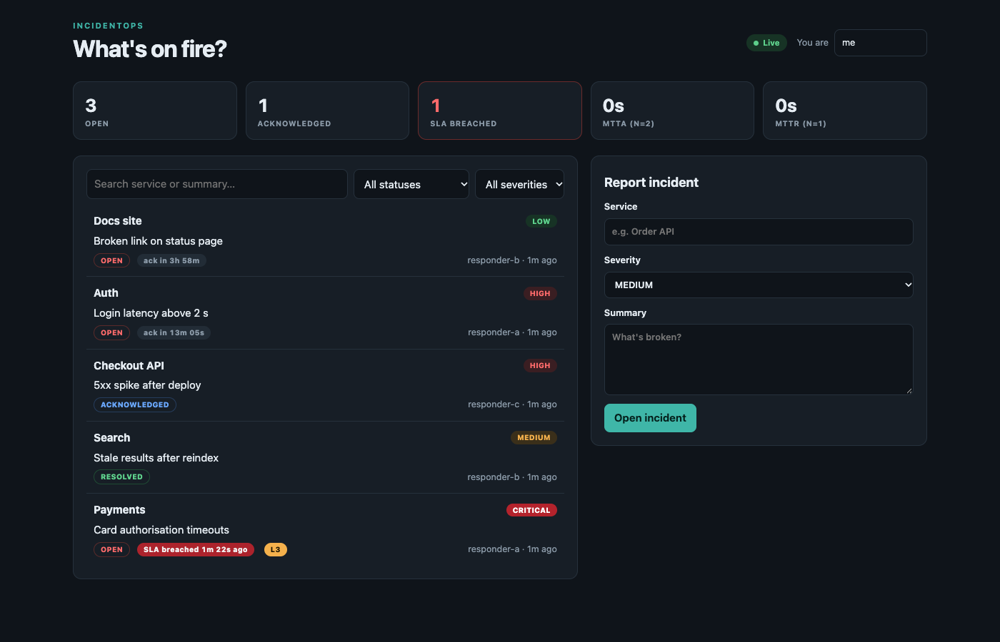
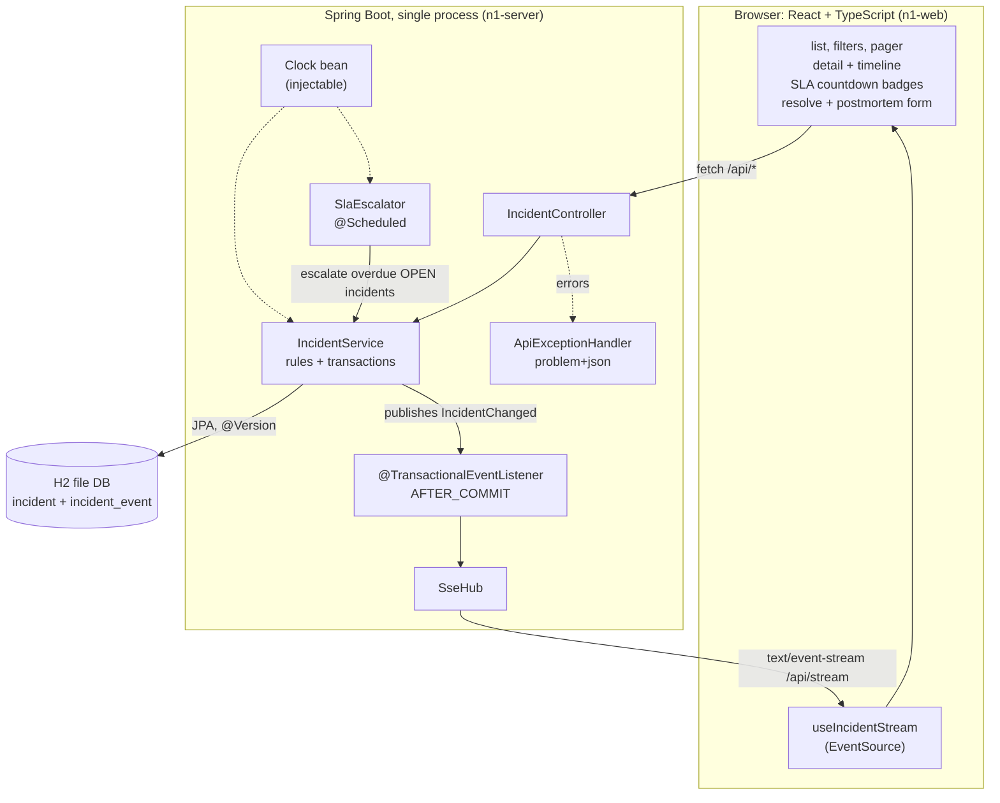
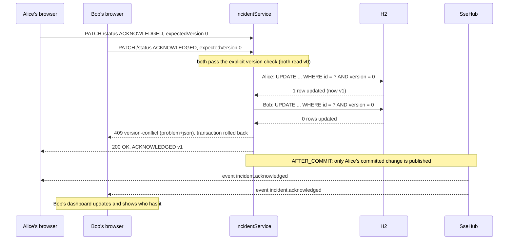
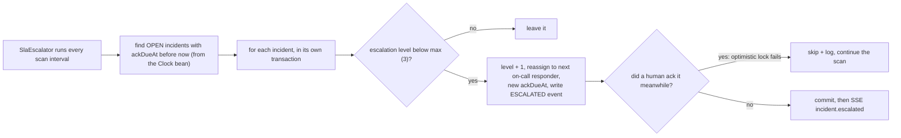
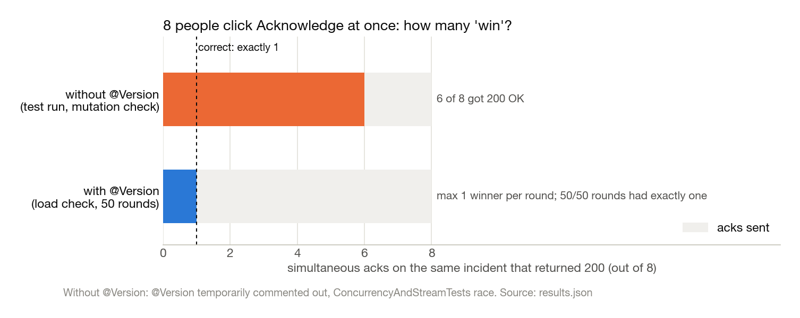
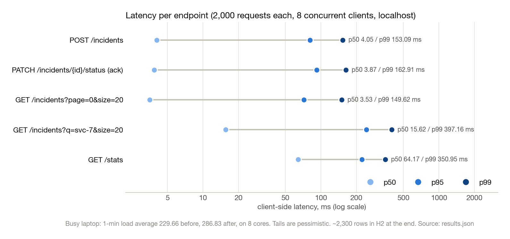
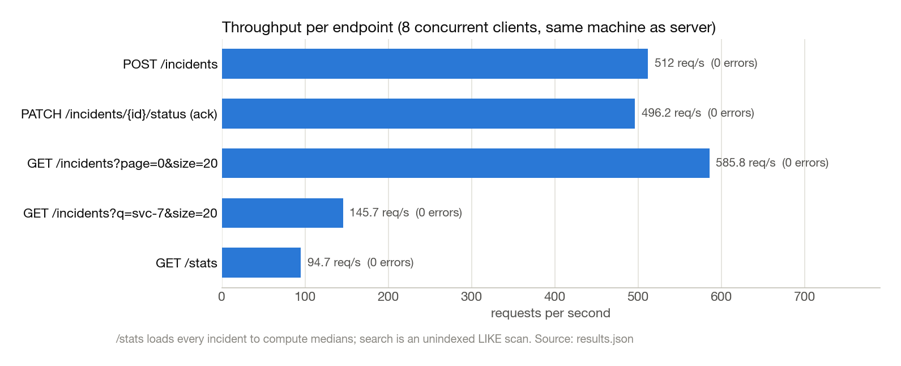

# IncidentOps

**An incident tracker where two people can't both "take" the same fire, everyone's screen updates live, and nobody-picked-it-up gets escalated automatically.**

Open an incident, someone acknowledges it, someone resolves it with a short postmortem. Everyone's dashboard updates live, and if nobody acks in time the server escalates it to the next person on call.

Java 17 / Spring Boot 4 / JPA + H2 on the back, React 19 + TypeScript + Vite on the front. No UI framework.

### TL;DR

- **Concurrent acks are safe:** 50/50 rounds of 8 simultaneous acks on the same incident had **exactly one winner**. With `@Version` commented out, **6 of 8** requests got `200 OK`.
- **Tests:** **45** backend tests (JUnit + MockMvc + a real-port race test) and **17** frontend tests (Vitest) pass.
- **Graceful shutdown with a live dashboard open** went from about 30 s (stuck on a dead SSE client) to **0.3 s**.
- **Writes and paged reads stay fast at the median:** p50 of 4.05 ms (create), 3.87 ms (ack) and 3.53 ms (list) on localhost, even on a laptop with a 1-min load average of 229.66–286.83 on 8 cores. The tails were not fast; see [Results](#results).



*The dashboard from a local run, seeded with five demo incidents: a CRITICAL one left unacked (SLA breached, escalated to level 3 by the scheduler), one acknowledged, one resolved with a postmortem, and two still inside their SLA. Placeholder responder names; nobody gets paged.*

## Why I built this

Picture a hackathon: the demo server falls over twenty minutes before judging, and three people on the team start fixing it at the same time. Nobody knows the others are on it. Two of them restart the same service and one of them reverts the other's fix.

That scenario is the whole project. I wanted to see what it takes for a tool to make "someone already has this" obvious and safe:

- if two people click **Acknowledge** at the same moment, exactly one of them wins and the other is told so;
- everyone's screen shows that within a second, without refreshing;
- if *nobody* picks it up, the system notices and pages the next person;
- afterwards there's a timeline of what actually happened, which can't be edited after the fact.

The first version of this repo was a plain CRUD tracker (create, filter, count, an `OPEN → ACKNOWLEDGED → RESOLVED` state machine, 3 tests). This version is the rewrite.

## Architecture



## What I built

| Feature | How |
|---|---|
| State machine `OPEN → ACKNOWLEDGED → RESOLVED` | Rules live on the `Status` enum + `Incident` entity; illegal moves → `409` with the allowed next states |
| Two people ack at once | JPA `@Version` optimistic locking + optional `expectedVersion` from the client → loser gets `409 version-conflict` |
| Append-only timeline | `IncidentEvent` is `@Immutable`; its repository has no update/delete methods. Every create/ack/comment/reassign/escalate/resolve writes one |
| SLA per severity | CRITICAL 5 min, HIGH 15 min, MEDIUM 1 h, LOW 4 h to acknowledge (configurable) |
| Auto-escalation | `@Scheduled` job finds OPEN incidents past `ackDueAt`, bumps escalation level (max 3), reassigns to the next responder, writes an `ESCALATED` event |
| On-call rotation | Round-robin across configured responders (placeholder names, nobody actually gets paged) |
| Postmortem on resolve | Root cause / impact / follow-up required to resolve (`422` without it) |
| Live dashboard | Server-Sent Events at `/api/stream`, sent only **after the DB transaction commits** |
| MTTA / MTTR | `/api/stats`: mean and median time-to-ack and time-to-resolve, plus open SLA breaches |
| API hygiene | Service layer, DTO records (entities never serialised), pagination + search + filters, all errors as RFC 7807 `application/problem+json` |
| Frontend | Live indicator, ticking SLA countdown badges (amber → red), timeline view, postmortem form, toast when someone else changes something, conflict message on 409 |

## How it works

The core idea is what happens when two people ack the same incident at the same instant:



And the escalation path, when nobody acks:



Some decisions and why:

- **Version check in two places.** The client sends the `version` it last saw. If it's stale we reject before touching anything, with a clear message. That alone doesn't cover two requests reading version 0 at the same instant, so `@Version` on the entity makes Hibernate write `UPDATE … WHERE version = ?`. The loser's update matches 0 rows, and that becomes the same `409`.
- **`saveAndFlush` before broadcasting.** Flushing inside the service makes a lost race fail *there*, not at commit time after we've already built an event.
- **SSE after commit only.** `@TransactionalEventListener(AFTER_COMMIT)` means a rolled-back change (e.g. the loser of the race) is never shown to anyone. There's a test for exactly that.
- **One transaction per escalated incident.** If a human acks between the scheduler's query and its update, only that one incident's escalation fails (optimistic lock), it's skipped and logged, and the rest of the scan continues.
- **Injectable `Clock`.** Every timestamp comes from a `Clock` bean. Tests swap in a clock they can move forward, so "wait 6 minutes for the SLA to expire" takes zero real time.
- **SSE, not WebSockets.** Updates only flow server → browser; actions are normal HTTP calls. SSE is plain HTTP, reconnects by itself in the browser, and needs no extra dependency.

## Things that surprised us

1. **How much `@Version` matters, measured.** I temporarily commented out `@Version` and reran the race test (8 threads ack the same incident at once). **6 of 8 requests got `200 OK`**, and the timeline would have shown six acknowledgements. With it back, exactly one wins. In the load script's race check that held for **50/50 rounds**.
2. **Dead SSE clients block shutdown.** Stopping the server after the demo script took ~30 s. The log said `1 bean still running after timeout of 30000ms: [webServerGracefulShutdown]`. The client had disconnected, but the server only finds out on its next write. Closing emitters in `@PreDestroy` was too late, because it runs *after* the graceful-shutdown wait. Moving it to a `ContextClosedEvent` listener brought shutdown with an open stream down to **0.3 s**.
3. **The schema change needed a new DB file.** v2 adds non-null columns; Hibernate's `ddl-auto=update` can't add them to rows that already exist. For a local project I pointed it at `data/incidentops-v2`. A real project would use Flyway/Liquibase migrations.
4. **Timeline and stats disagreed by a second.** One rounded the ack time to 1 s while the other said 0 s, because two different ways of computing durations were in use. Both now use `Duration.toSeconds()`.

## Results

All numbers are from runs on 2026-11-09 on an Apple M2 (8 cores, 8 GB) and are recorded in [`results.json`](results.json) with the exact commands. The charts are drawn by [`scripts/make_figures.py`](scripts/make_figures.py) straight from that file.

| Check | Result |
|---|---|
| Backend tests (`./mvnw test`) | **45 passed**, 0 failed (20 API, 12 state machine, 5 SLA, 4 concurrency/SSE, 3 rotation, 1 context) |
| Concurrency tests repeated | 5 consecutive runs, 0 failures |
| Same tests with `@Version` removed | 2 of 4 fail; 6 of 8 concurrent acks "win" |
| Frontend tests (`npm test`, Vitest) | **17 passed** |
| Frontend build | OK, 73.90 kB gzipped JS |
| Live HTTP flow (`scripts/demo_flow.sh`) | All steps as expected, incl. scheduler escalation and 7 SSE events received |
| Race check: 50 rounds × 8 simultaneous acks | **50/50 rounds had exactly one winner** |



Latency from `scripts/loadcheck.py` (2,000 requests per row, 8 concurrent clients, localhost, after warm-up, ~2,300 rows in H2 at the end). **The machine was heavily loaded by unrelated processes during this run** (1-min load average 229.66 before and 286.83 after, on 8 cores), so treat the tails as pessimistic:



| Endpoint | p50 | p95 | p99 | req/s | errors |
|---|---|---|---|---|---|
| `POST /incidents` | 4.05 ms | 80.66 ms | 153.09 ms | 512.0 | 0 |
| `PATCH /incidents/{id}/status` (ack) | 3.87 ms | 92.22 ms | 162.91 ms | 496.2 | 0 |
| `GET /incidents?page=0&size=20` | 3.53 ms | 71.83 ms | 149.62 ms | 585.8 | 0 |
| `GET /incidents?q=svc-7&size=20` (search) | 15.62 ms | 243.52 ms | 397.16 ms | 145.7 | 0 |
| `GET /stats` | 64.17 ms | 222.26 ms | 350.95 ms | 94.7 | 0 |



`/stats` is the slowest because it loads every incident into memory to compute medians. Search is an unindexed `LIKE '%…%'` scan. Both are fine at a couple of thousand rows and would be the first things to fix if this grew.

### What the numbers do NOT show

- **Production capacity.** Client and server shared one heavily loaded laptop. The latency numbers show the relative cost between endpoints, nothing more. The big gap between p50 and p95 is at least partly the other processes on the machine.
- **Multi-instance behaviour.** Everything ran as one server process; the race result says nothing about two servers (see limits below).
- **Real users.** There were none. The race is 8 threads in a script, not 8 people.
- **The "without `@Version`" number is one test run.** It shows the failure is real, not how often it happens.

## Run it yourself

**Prerequisites:** Java 17+, Node 20.19+ / 22.12+, and Python 3 for the scripts (plus `matplotlib` only if you want to redraw the charts). No cloud accounts.

**Setup:**

```sh
git clone https://github.com/nikhils23j/incidentops.git
cd incidentops
cd n1-web && npm ci && cd ..
```

**Quickstart** (two terminals):

```sh
# terminal 1: backend
cd n1-server
./mvnw spring-boot:run         # http://localhost:8080/api

# terminal 2: frontend
cd n1-web
npm run dev                    # http://localhost:5173 (proxies /api to :8080)
```

Open two browser windows side by side, ack an incident in one and watch the other update.

**Full evaluation** (live flow, escalation and load check). To see escalation without waiting 5 minutes, start the jar with a short CRITICAL SLA:

```sh
cd n1-server && ./mvnw -q -DskipTests package && cd ..
java -jar n1-server/target/incidentops-0.0.1-SNAPSHOT.jar --incidentops.ack-sla.CRITICAL=8s --incidentops.sla.scan-interval-ms=1000
# another terminal, from the repo root:
./scripts/demo_flow.sh                                                    # end-to-end HTTP flow + SSE + escalation
python3 -I scripts/loadcheck.py --requests 2000 --concurrency 8 --race-rounds 50   # better on a server with default SLAs
python3 scripts/make_figures.py                                           # redraw docs/img charts from results.json
```

Expected runtime: the backend test suite took 46.994 s (Maven total time) on my M2, the frontend tests about a second, and `demo_flow.sh` waits 11 s for the scheduler to escalate. I didn't record the load check's wall time.

### API

| Method | Path | Notes |
|---|---|---|
| GET | `/api/incidents?status=&severity=&assignee=&q=&page=&size=&sort=newest\|oldest` | page size capped at 100 |
| POST | `/api/incidents` | `{serviceName, severity, summary, reporter?}` |
| GET | `/api/incidents/{id}` | |
| PATCH | `/api/incidents/{id}/status` | `{status, expectedVersion?, actor?, postmortem?}` |
| PATCH | `/api/incidents/{id}/assignee` | `{assignee, expectedVersion?, actor?}` |
| GET | `/api/incidents/{id}/events` | timeline, oldest first |
| POST | `/api/incidents/{id}/comments` | `{author, message}` |
| GET | `/api/stats` | counts, open SLA breaches, MTTA/MTTR mean + p50 (seconds) |
| GET | `/api/metrics` | v1 counts endpoint, kept for compatibility |
| GET | `/api/oncall` | rotation + SLA seconds per severity |
| GET | `/api/stream` | `text/event-stream`: `hello`, `incident.created`, `.acknowledged`, `.resolved`, `.commented`, `.assigned`, `.escalated` |

## Tests

```sh
cd n1-server && ./mvnw test    # 45 tests
cd n1-web && npm test          # 17 tests (Vitest)
```

Backend (45):

- **`IncidentApiTests` (20, MockMvc):** create returns 201 with assignee and SLA deadline, validation and unknown-id errors as problem+json, pagination, search and filters, illegal transitions (409 with allowed next states), stale `expectedVersion` (409, nothing changes), postmortem required (422), ordered append-only timeline, MTTA/MTTR stats, legacy `/metrics`, `/oncall`.
- **`IncidentStateMachineTest` (12, unit):** all 9 (from, to) status pairs plus 3 more rules.
- **`SlaEscalationTests` (5, MockMvc + fake `Clock`):** not escalated before the deadline but escalated after, acked incidents never escalate, re-escalation up to the cap, SLA window per severity, open-breach count in stats.
- **`ConcurrencyAndStreamTests` (4, real Tomcat on a random port):** 8 simultaneous acks → exactly one wins, `@Version` rejects the second of two interleaved writers, a dashboard stream receives someone else's ack, rejected changes are never broadcast.
- **`OnCallRotationTest` (3, unit)** and **`IncidentopsApplicationTests` (1, context loads)**.

Frontend (17, Vitest + jsdom): countdown / SLA-state / relative-time helpers in `time.ts` (10), mapping problem+json errors to UI messages in `api.ts` (4, e.g. version conflict vs illegal transition), and the `SlaBadge` component (3: counts down, shows breach + escalation level, hides once acknowledged).

There is no CI pipeline in this repo; these are run by hand.

## Project layout

```
.
├── n1-server/                       Spring Boot backend (./mvnw)
│   └── src/
│       ├── main/java/dev/nikhil/incidentops/
│       │   ├── domain/              Incident, IncidentEvent, Status, Severity, repositories
│       │   ├── service/             IncidentService, SlaEscalator, OnCallRotation, StatsService
│       │   ├── stream/SseHub.java   SSE subscribers, broadcast after commit
│       │   ├── web/                 IncidentController, ApiExceptionHandler (problem+json)
│       │   ├── api/Dtos.java        request/response records
│       │   └── config/              Clock bean, incidentops.* properties
│       └── test/java/...            45 tests (MockMvc, fake Clock, real-port race)
├── n1-web/                          React 19 + TypeScript + Vite dashboard
│   └── src/
│       ├── App.tsx, api.ts, useIncidentStream.ts, useNow.ts, time.ts
│       └── components/              CreateForm, IncidentDetail, Timeline, ResolveDialog, SlaBadge
├── scripts/
│   ├── demo_flow.sh                 end-to-end HTTP flow against a running server
│   ├── loadcheck.py                 latency + race check (stdlib only)
│   └── make_figures.py              README charts, reads only results.json
├── docs/img/                        charts + dashboard screenshot
└── results.json                     every number in this README, with commands
```

## What this isn't / limits

- **No authentication.** "Actor" / "author" is whatever name the client sends. Anyone can act as anyone.
- **Not deployed anywhere, no real users.** It runs on a laptop with an embedded H2 file database.
- **Single instance only.** SSE subscribers and the rotation cursor live in memory; a second server wouldn't see the first one's events. Scaling out would need a shared broker (Postgres LISTEN/NOTIFY, Redis, …) and a lock so only one node runs the SLA job.
- **Nobody gets paged.** "Paged responder-b" is a timeline entry, not an SMS or a phone call.
- **No schema migrations.** Hibernate `ddl-auto=update` creates the schema.
- **The latency numbers are localhost on a busy laptop**, client and server on the same machine. They show relative cost between endpoints, not production capacity.
- **Timeline is append-only at the application level.** Nothing in the app can edit it, but someone with database access could. It's not tamper-proof.
- **`npm audit` reports 3 findings** (1 moderate, 2 critical) in vitest 3.2.x's dev-only dependency tree; they're not in the production bundle. The fix is vitest 4, which failed to install here.

## More

- [`results.json`](results.json): raw numbers, environment and exact commands.

## Reproducibility

I ran every number in this README and checked it against the logs in `results.json`.
